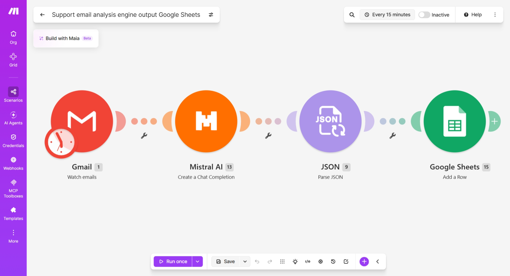

# Support Email Analysis Engine (output: Google Sheets)

A scenario that reads incoming customer support emails, uses an AI model (Mistral) to extract the key information (customer, order, issue type, urgency, requested action...), and logs each email as a row in Google Sheets.

Other versions of this scenario:
- [Notion](https://github.com/phillarr/Support-email-analysis-engine-output-Notion)
- [Excel](https://github.com/phillarr/Support-email-analysis-engine-output-Excel): uses a Mistral agent and also extracts `CustomerSince`

## The scenario



```
Gmail (new email) ──► Mistral AI (extract as JSON) ──► Parse JSON ──► Google Sheets (add row)
```

## What it does

1. **Watch new emails** (Gmail): checks your inbox for new messages.
2. **Analyze the email** (Mistral AI, `mistral-medium-latest`, JSON mode): sends the subject, sender and body to the model. The model only extracts what is explicitly written, keeps the original wording, and returns `null` for missing fields:
   - `CustomerName`: a name written in the email body (not taken from the email address)
   - `OrderNumber`: an order, reference or ticket number
   - `TrackingNumber`: a shipment tracking number
   - `IssueType`: `delivery`, `billing`, `product`, `refund` or `other`
   - `RequestedAction`: what the customer explicitly asks for
   - `UrgencyLevel`: `high`, `medium` or `low`
   - `ProductMentioned`: the main product mentioned
3. **Parse JSON**: turns the model's reply into structured data.
4. **Add a row** (Google Sheets): logs the analysis with a timestamp.

> **The AI can make mistakes.** It can mix up an order number and a tracking number, pick the wrong issue type or misjudge urgency. Use the sheet to sort and prioritize, but check the original email before answering the customer.

## Requirements

- A Make.com account (the free plan is enough to try it)
- A Gmail account
- A Mistral AI API key ([console.mistral.ai](https://console.mistral.ai))
- A Google account (Sheets)

## Google Sheet setup

Create a spreadsheet with these headers in the first row:

| Header           | Filled with                 |
|------------------|-----------------------------|
| TimeStamp        | Date and time of processing |
| CustomerName     | `CustomerName`              |
| OrderNumber      | `OrderNumber`               |
| TrackingNumber   | `TrackingNumber`            |
| IssueType        | `IssueType`                 |
| RequestedAction  | `RequestedAction`           |
| UrgencyLevel     | `UrgencyLevel`              |
| ProductMentioned | `ProductMentioned`          |

## Installation

1. Download [`Support email analysis engine output Google Sheets.blueprint.json`](Support%20email%20analysis%20engine%20output%20Google%20Sheets.blueprint.json).
2. In Make, create a new scenario, open the **⋯** menu, choose **Import Blueprint** and select the file.
3. Reconnect each module to your own accounts:
   - **Gmail**: add your connection.
   - **Mistral AI**: add a connection with your API key.
   - **Google Sheets**: pick **your** spreadsheet and sheet.
4. In the **Parse JSON** module, rebuild the data structure if Make asks for it.
5. Click **Run once** and send yourself a test email, for example:
   > Hello, I ordered a pair of headphones (order #A-58213) but the tracking number 1Z999AA10123456784 hasn't moved in a week. Can you send a replacement? Thanks, Maria Lopez
6. Turn on scheduling when you are happy with the result.

## Customizing

- **Fields and categories**: edit the extraction rules and allowed values in the Mistral system prompt.
- **Model**: any Mistral model works. A lower `temperature` (for example `0.2`) gives more consistent extraction.
- **Alerts**: add a filter after Parse JSON to notify your team when `UrgencyLevel` is `high`.
- **Email filter**: limit the Gmail trigger to your support inbox or a label.

## Privacy and security

- **Email contents are sent to Mistral AI** for processing. Only use this with mailboxes whose data you are allowed to share with a third-party AI provider.
- **API keys and OAuth tokens stay in your Make connections** and are never exported in the blueprint.
- **Emails are untrusted input.** Someone could write an email designed to trick the AI (prompt injection) and fill the sheet with misleading data.

## License

[MIT](LICENSE)
